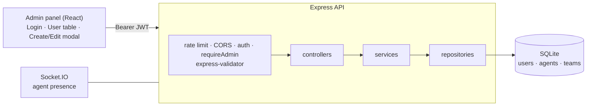

# Agent Wallboard — User Management (Admin Panel + API)

**A user-management module for a call-center wallboard: a React admin panel for creating, editing, filtering and soft-deleting users, backed by a layered Express API with JWT auth, admin-only access control, request validation and SQLite, plus real-time agent presence over WebSockets.**


> **ENGSE203 Computer Programming for Software Engineers, Task 1.** Part of the Agent Wallboard case study.

## Architecture



## Features

- **User CRUD** with filters (role, status), validation on every input, and **soft delete** (`deletedAt`) so history is kept
- **Admin-only access:** all `/api/users` routes need a valid JWT from an *Admin*. Members get `403`, anonymous requests get `401`
- **Layered backend:** routes → controllers → services → repositories, with schema migrations applied automatically on first start
- **Database integrity:** foreign keys between users and teams, `CHECK` constraints on role and status, and an `updatedAt` trigger
- **Real-time presence:** agents and supervisors connect over Socket.IO, and supervisors are notified when agents come online or go offline
- **Protection:** rate limiting (stricter on `/api/auth`) and configurable CORS

## Run it

```bash
git clone https://github.com/tawan230666/Task1-User-Management.git
cd Task1-User-Management

# API → http://localhost:3001
cd backend-server
cp .env.example .env
npm install
npm run seed        # creates the schema and sample users
npm run dev

# Admin panel → http://localhost:3000 (new terminal)
cd admin-panel
cp .env.example .env
npm install
npm start
```

Log in as **`AD001`** or **`AD002`** (admins). `AG001` and `SV001` exist too, but they're refused by the admin panel.

`Task1-API-Tests.postman_collection.json` contains requests for every endpoint.

## API

| Method | Endpoint | Access |
|---|---|---|
| `POST` | `/api/auth/login` | public |
| `GET` | `/api/users` (filters: `role`, `status`) | admin |
| `GET` | `/api/users/:id` | admin |
| `POST` | `/api/users` | admin |
| `PUT` | `/api/users/:id` | admin |
| `DELETE` | `/api/users/:id` (soft delete) | admin |
| `GET` | `/api/agents/team/:teamId`, `/api/agents/:agentCode/history` | — |
| `PUT` | `/api/agents/:agentCode/status` | — |
| `POST` | `/api/messages/send` · `GET /api/messages/agent/:agentCode` · `PUT /api/messages/:messageId/read` | — |
| `GET` | `/health` | public |

## Known limitations

- **Login is username-only** (no password), a simplification required by the lab brief. A production version would add bcrypt-hashed passwords.
- MongoDB support is optional and off by default (`ENABLE_MONGO=true` to enable).

## Project structure

```
admin-panel/        React app: LoginPage, UserManagementPage, UserTable, UserFormModal
backend-server/
  routes/           auth, users, agents, messages
  controllers/  services/  repositories/
  middleware/       auth (JWT), validation (express-validator), error handler
  socket/           Socket.IO presence handler
  scripts/seed.js   Creates the schema and sample data
database/
  scripts/          Ordered SQL migrations + sample data
```

---

**Author:** Tawan Tiphkun (ธาวัน ทิพคุณ), [@tawan230666](https://github.com/tawan230666), Software Engineering, RMUTL Chiang Mai
